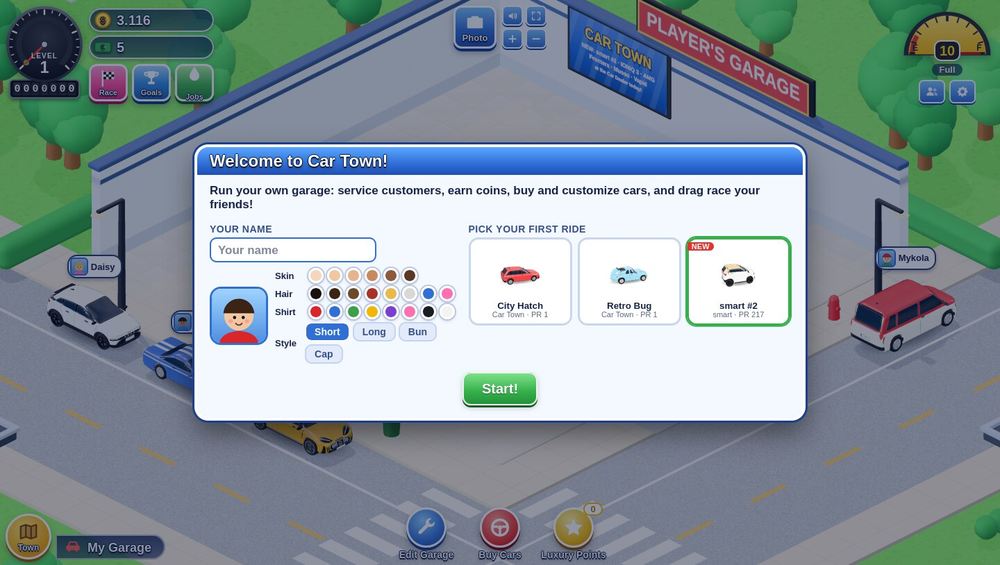
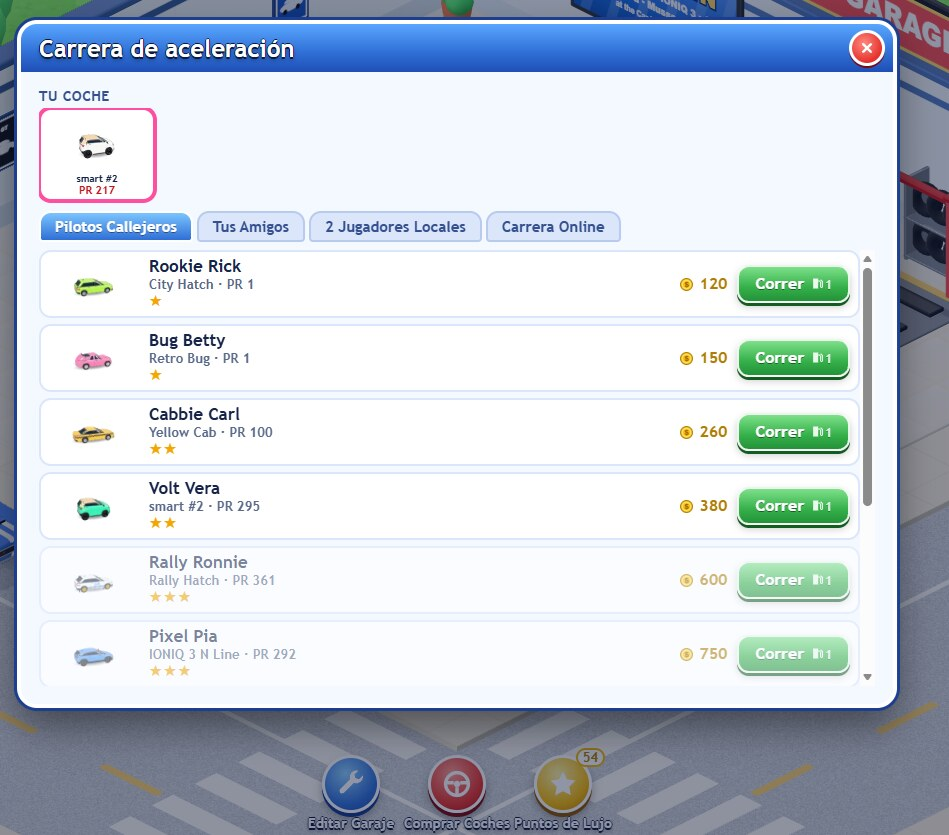
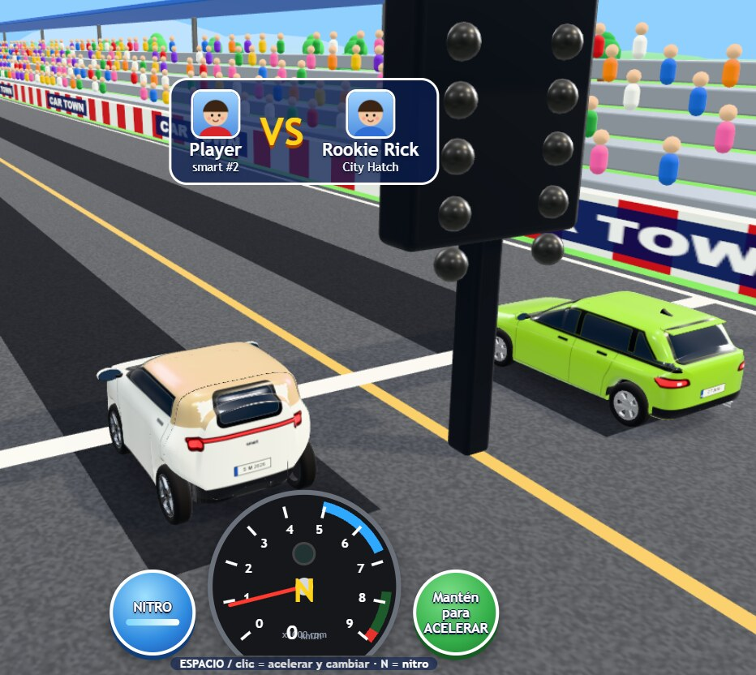
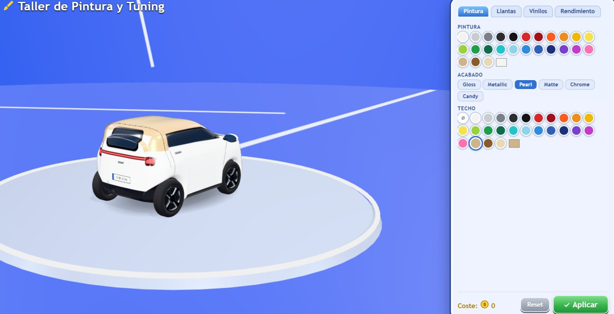
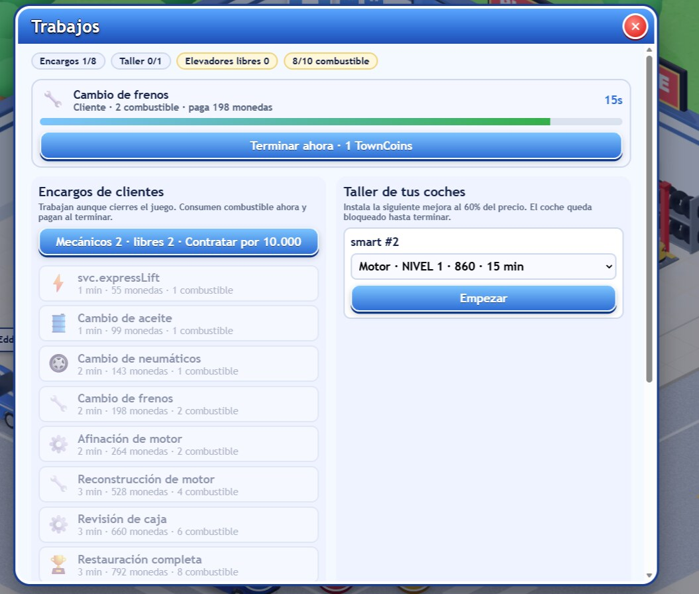
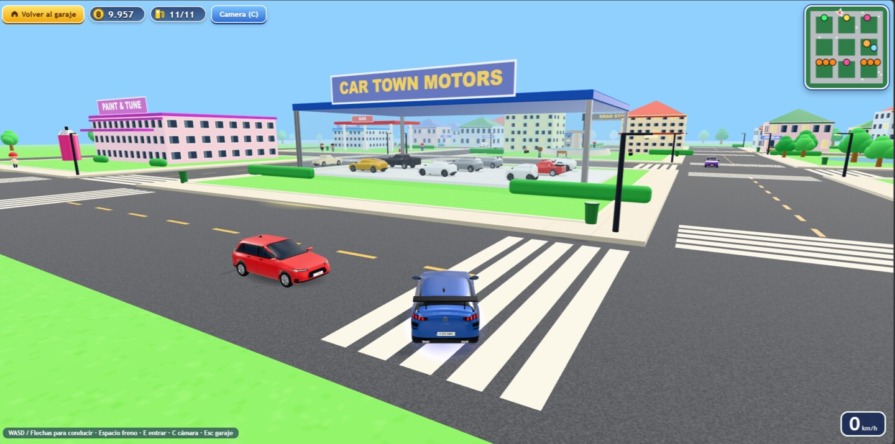
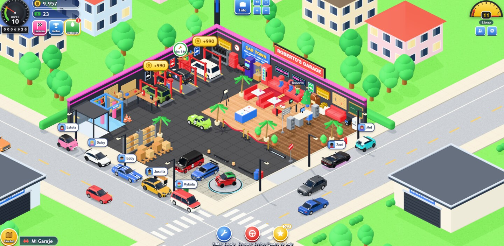
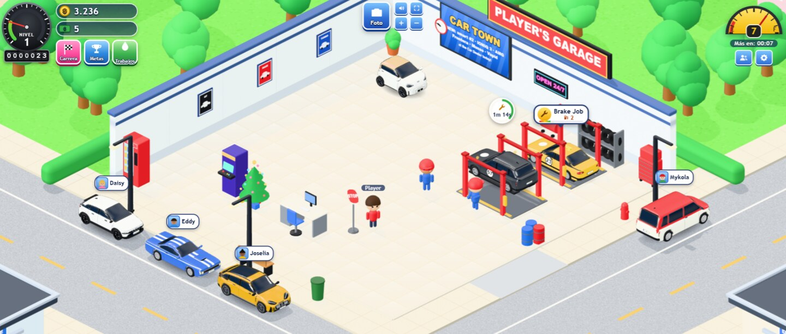

# Manual de Car Town — remake 3D

**Car Town** es un remake 3D para navegador del clásico juego social de garaje. No es un proyecto oficial ni comercial: es una reconstrucción fan-made creada con three.js. Todos los modelos, texturas y sonidos se generan por código; no hay mallas ni archivos de audio externos.

Este manual reúne lo necesario para **jugar** (garaje, coches, trabajos, carreras y amigos) y lo esencial para **administrar** una instalación (cuentas, panel web, guardado, despliegue y copias de seguridad). Los nombres de marca y modelo se usan solo para identificar los coches recreados.

## Índice

1. [Qué es el juego](#1-qué-es-el-juego)
2. [Acceso, registro y cuentas](#2-acceso-registro-y-cuentas)
3. [Interfaz principal y garaje](#3-interfaz-principal-y-garaje)
4. [Coches, tienda y personalización](#4-coches-tienda-y-personalización)
5. [Clientes, trabajos, tutorial y progresión](#5-clientes-trabajos-tutorial-y-progresión)
6. [Carreras y selección de rivales](#6-carreras-y-selección-de-rivales)
7. [Amigos y multijugador](#7-amigos-y-multijugador)
8. [Controles: teclado, ratón y pantalla táctil](#8-controles-teclado-ratón-y-pantalla-táctil)
9. [Guardado, partidas y sesiones](#9-guardado-partidas-y-sesiones)
10. [Panel de administración](#10-panel-de-administración)
11. [Instalación local y despliegue](#11-instalación-local-y-despliegue)
12. [Mantenimiento y copias de seguridad](#12-mantenimiento-y-copias-de-seguridad)
13. [Solución de problemas](#13-solución-de-problemas)
14. [Preguntas frecuentes](#14-preguntas-frecuentes)
15. [Galería de capturas](#15-galería-de-capturas)

---

## 1. Qué es el juego

Car Town combina gestión de taller, coleccionismo de coches, conducción ligera y carreras de cuarto de milla.

| Actividad | Qué haces | Recompensa habitual |
| --- | --- | --- |
| Atender clientes | Recibes coches NPC que piden aceite, neumáticos, frenos, puesta a punto, lavado, encerado o repintado. | Monedas, experiencia, propinas y puntos de lujo. |
| Trabajar en el taller | Aceptas hasta dos encargos en tiempo real y reservas el hueco de mejora. | Dinero, XP y una instalación de pieza con descuento. |
| Comprar y tunear | Eliges coches en el concesionario y cambias pintura, llantas, vinilos, mecánica, etc. | Coches más rápidos y mejor presentados. |
| Decorar | Compras, mueves, giras y vendes objetos del garaje; cambias suelos, paredes y tamaño. | Garaje propio y más estaciones de servicio. |
| Conducir | Sales a una ciudad con tráfico, peatones y minimapa. | Acceso a tiendas, pista, gasolinera, lavadero y casas de amigos. |
| Correr | Enfrentas a IA, amigos NPC, rivales en línea o a un segundo jugador. | Premios y progreso. |
| Socializar | Añades amigos, publicas en el muro, das me gusta, envías retos y visitas garajes. | Clasificación y comunidad. |

El bucle típico es: **entrar en el garaje → atender clientes → ganar monedas y XP → comprar o mejorar coches → correr o conducir → ampliar el garaje → repetir**.

### Aspecto del garaje y la ciudad



*Garaje isométrico con coches, elevadores y entorno de ciudad; desde aquí se accede a la mayoría de las funciones.*

---

## 2. Acceso, registro y cuentas

### 2.1 Cómo entrar

1. Abre la URL pública de tu instalación seguida de la ruta `/cartown/login`. Si el despliegue sirve el juego en la raíz, usa directamente la ruta de inicio de sesión configurada.
2. Si ya tienes cuenta, introduce **Usuario** y **Contraseña** y pulsa **Entrar al garaje**.
3. Si no tienes cuenta, sigue el enlace **Crear una cuenta**.
4. En la primera visita puedes elegir idioma: **español**, **inglés** o **portugués de Brasil**. El tutorial aparecerá guidado en ese idioma.

El panel de administración se abre en `/cartown/admin`, pero solo después de iniciar sesión con una cuenta con rol de administrador.

### 2.2 Registro

| Campo | Qué poner | Notas |
| --- | --- | --- |
| Usuario | 3–20 caracteres: letras, números, punto, guion o guion bajo. | Es tu identificador en esta instalación. |
| Nombre visible | El nombre que verán otros jugadores. | Puede diferir del usuario. |
| Contraseña | La que quieras usar. | No tiene mínimo de caracteres; el servidor rechaza una contraseña vacía y limita el máximo a 128 caracteres. Se almacena con scrypt. |
| Repite la contraseña | La misma contraseña. | Confirma que no hay error de escritura. |
| Código de invitación | Solo si la instalación lo exige. | El registro está abierto por defecto, pero el administrador puede cerrarlo o pedir código. |

No se usa correo electrónico: las cuentas son **locales a la instalación**. Guarda tus credenciales en un lugar seguro; este manual no incluye ejemplos de contraseñas ni cuentas de prueba.

### 2.3 Sesiones

- Las sesiones se guardan en el servidor, no solo en el navegador.
- La duración por defecto es de **30 días** y puede cambiarse en la configuración del servidor.
- Si otra persona administra el servidor y restablece tu contraseña, las sesiones anteriores se revocan.
- Cada usuario tiene su propia partida: coches, garaje, trabajos, dinero, nivel y estadísticas.

---

## 3. Interfaz principal y garaje

### 3.1 Lectura del HUD

El HUD está dividido en zonas:

| Zona | Elementos | Para qué sirve |
| --- | --- | --- |
| Arriba a la izquierda | Velocímetro/cuenta de XP, odómetro, **monedas**, **Car Town Cash**, **Carrera**, **Metas** y **Trabajos**. | Consultar recursos y abrir carreras, objetivos y encargos. Los botones pueden mostrar una insignia cuando hay novedades. |
| Arriba en el centro | **Foto**, sonido, pantalla completa y controles de zoom. | Capturar imagen, silenciar/activar audio y acercar o alejar la vista. |
| Arriba a la derecha | Indicador de **combustible**, **Amigos** y **Ajustes**. | Ver fuel, abrir lo social y repetir el tutorial o cambiar opciones. |
| Abajo a la izquierda | **Ciudad** y etiqueta **Mi Garaje**. | Salir a conducir o volver al garaje. |
| Abajo en el centro | **Editar Garaje**, **Comprar Coches** y **Puntos de Lujo**. | Decorar, ir al concesionario y consultar lujo. |

### 3.2 Moverse por el garaje

- **Arrastra** con el ratón o el dedo para desplazar la vista isométrica.
- Usa la **rueda del ratón**, los botones `+`/`−` del HUD o las teclas `+`/`−` para acercar y alejar.
- Haz clic en **coches** y **clientes** para interactuar.
- En el editor, `R` gira el objeto seleccionado y `Esc` cancela.

### 3.3 Editor de garaje

Desde **Editar Garaje** puedes comprar, colocar, mover, girar y vender:

- Elevadores y estaciones de servicio.
- Lavadero y cabina de pintura.
- Arcade, jukebox, mesas y herramientas.
- Alfombras, baldosas y otros parches planos.
- Barreras de terciopelo y elementos decorativos.

También hay **temas de suelo y pared** y **ampliaciones del solar**. Algunas herramientas pequeñas se ajustan automáticamente a las mesas.

> Consejo: cada estación solo admite el servicio correspondiente. Si un trabajo indica que falta una estación, revisa la decoración del garaje antes de aceptar más encargos.

---

## 4. Coches, tienda y personalización

### 4.1 Concesionario

Pulsa **Comprar Coches** en la parte inferior del HUD.

1. Compara los vehículos disponibles: el concesionario muestra **21 vehículos integrados**, estadísticas y ocho modelos destacados. También pueden aparecer **coches personalizados creados por administradores**.
2. Revisa datos como **potencia**, **peso**, **agarre**, **1/4 de milla**, **velocidad máxima** y **precio**.
3. Elige el **color inicial** antes de comprar.
4. Compra con las monedas disponibles; algunos vehículos pueden requerir nivel o Car Town Cash según la configuración de la partida.
5. Si el garaje está lleno, amplíalo o vende un coche.

Los coches nuevos se añaden a tu colección. Para usar uno en carreras o en la ciudad, selecciónalo como **coche activo** desde la fila de coches del menú de carreras o desde la interfaz correspondiente.

### 4.2 Personalización

La herramienta **Personalizar** permite modificar:

| Categoría | Opciones visibles |
| --- | --- |
| Apariencia | Pintura, acabado, techo bicolor, llantas (13 diseños), color de llanta, pinzas, vinilos, color del vinilo, kit de carrocería y alerón. |
| Cristales y luz | Cristales tintados y neón/underglow. |
| Altura | Ajuste de altura/stance. |
| Rendimiento | Motor, turbo, cambio, neumáticos, peso y nitro. |

Flujo recomendado:

1. Abre **Personalizar** sobre el coche que quieras.
2. Prueba combinaciones de pintura, llantas y vinilos.
3. Añade mejoras de rendimiento según el tipo de carrera que quieras correr.
4. Revisa el **coste** y pulsa **Aplicar** cuando estés de acuerdo.

El taller tiene **un hueco de mejora**: al reservarlo puedes instalar la siguiente pieza con un descuento del **60 % del precio** respecto a la instalación normal.

### 4.3 Menú de carreras y miniaturas 3D



*Menú de Carreras: selección de coche, pestañas de rivales y miniaturas 3D de los vehículos.*

---

## 5. Clientes, trabajos, tutorial y progresión

### 5.1 Clientes

Los coches NPC llegan al garaje, aparcan y piden un servicio:

- Aceite.
- Neumáticos.
- Frenos.
- Puesta a punto o tuning.
- Lavado.
- Encerado.
- Repintado.

Cada servicio consume recursos —incluido combustible— y entrega monedas, experiencia y propinas. La pantalla de trabajos muestra estados como **Servicio**, **Esperando**, **Listo: recoger** y **Marchándose**.

### 5.2 Trabajos del jugador

Además de los clientes que llegan, puedes aceptar hasta **dos encargos en tiempo real**:

1. Abre **Trabajos** desde el HUD.
2. Elige un encargo compatible con tus estaciones y mecánicos.
3. Cada mecánico atiende un coche; puedes contratar hasta **6 mecánicos**.
4. Espera a que termine el temporizador; el progreso se calcula por fecha (`endsAt`).
5. Recoge la recompensa cuando aparezca **Listo: recoger**.

Si todos los mecánicos están ocupados, contrata otro o espera. Si falta una estación, instálala desde el editor.

### 5.3 Tutorial

- El tutorial guiado está disponible en español, inglés y portugués de Brasil.
- Sus pasos se guardan: si sales y vuelves, puedes continuar.
- Resalta controles y elementos concretos, con avisos accesibles y texto de respaldo.
- Puedes repetirlo desde **Ajustes** (**Repetir tutorial**).
- Al completarlo se marcan los pasos como hechos.

### 5.4 Progresión

| Recurso | Cómo se obtiene | Uso principal |
| --- | --- | --- |
| Monedas | Servicios, trabajos y carreras. | Comprar coches, piezas y objetos. |
| Experiencia y nivel | Servicios, metas y carreras. | Desbloquear vehículos y rivales; mostrar progreso. |
| Puntos de lujo | Actividades del garaje y servicios. | Elemento de progreso mostrado en el HUD. |
| Combustible | Recarga con el tiempo o visita a la gasolinera. | Conducir y disputar algunas carreras. |

Las **Metas** del HUD recogen objetivos y recompensas. Los rivales de calle tienen niveles de dificultad: los de nivel superior se desbloquean al subir de nivel.

---

## 6. Carreras y selección de rivales

Pulsa **Carrera** en el HUD para abrir el menú.

### 6.1 Preparación

1. Selecciona uno de tus coches en la fila superior; se muestra su miniatura 3D y su clasificación **PR**.
2. Elige una pestaña:

| Pestaña | Contenido |
| --- | --- |
| **Calle** | Rivales IA con nombre, coche, estrellas de dificultad, premio y coste de combustible. |
| **Amigos** | Amigos NPC o amigos de la cuenta que se puedan retar. |
| **Local** | Duelo a dos jugadores en el mismo teclado. |
| **En línea** | Salas y rivales en línea mediante WebSocket. |

3. Pulsa **Desafiar** en el rival deseado. Los rivales bloqueados indican el nivel necesario.
4. Las carreras de calle y contra amigos consumen combustible; la carrera del tutorial es una excepción.
5. Si vas a la pestaña en línea, cierra el menú correctamente para salir de la sala cuando termines.

### 6.2 Desarrollo de la carrera



*Carrera de cuarto de milla: semáforo de salida, tacómetro, marcha, velocidad y nitro.*

La carrera es de **cuarto de milla**:

1. Espera al árbol de salida y al semáforo.
2. **Mantén pulsado** para revolucionar antes de salir; la zona azul del tacómetro marca la salida eficaz.
3. Tras la salida, pulsa para **cambiar de marcha** cuando el tacómetro esté en la **zona verde**.
4. Usa el **nitro** en el momento que consideres oportuno; la barra muestra cuánto queda.
5. Observa distancia, velocidad y marcha de ambos coches.
6. Al terminar verás el resultado, los premios y, cuando corresponda, la opción de **revancha**. Las carreras online no ofrecen revancha desde el mismo panel.

### 6.3 Carrera a dos jugadores

| Jugador | Revolucionar/cambiar | Nitro |
| --- | --- | --- |
| Jugador 1 | `Z` | `X` |
| Jugador 2 | `M` | `N` |

Ambos comparten el mismo teclado y cada uno tiene su tacómetro y su botón de nitro en pantalla.

---

## 7. Amigos y multijugador

Desde el botón **Amigos** del HUD:

- Añade usuarios por **nombre de usuario** o por **código**.
- Publica en el **muro** y da **me gusta** a publicaciones.
- Envía **retos** a amigos.
- Visita el garaje de amigos o bots en **modo solo lectura**: puedes verlo y dar me gusta, pero no editarlo.
- Consulta el **ranking global**. La visibilidad en la clasificación se puede ocultar desde la administración.

### Tipos de multijugador

| Modalidad | Dónde | Características |
| --- | --- | --- |
| Amigos NPC | Pestaña **Amigos** de carreras. | Rivales incorporados al juego, algunos con coche y nivel propios. |
| Local | Pestaña **Local**. | Dos jugadores, un teclado, teclas separadas. |
| En línea | Pestaña **En línea**. | Salas WebSocket con progreso de carrera compartido. |
| Social asíncrono | Panel **Amigos**. | Muro, me gusta, retos, visitas y clasificación. |

Los administradores pueden crear bots visitables y retables, así como copiar garajes entre cuentas y bots.

---

## 8. Controles: teclado, ratón y pantalla táctil

### 8.1 Teclado y ratón

| Zona | Acción | Control |
| --- | --- | --- |
| Garaje | Desplazar vista | Arrastrar con ratón o dedo. |
| Garaje | Acercar / alejar | Rueda del ratón, `+` / `−` o botones de zoom del HUD. |
| Garaje | Interactuar | Clic en coches y clientes. |
| Editor | Girar objeto | `R`. |
| Editor | Cancelar | `Esc`. |
| Concesionario | Comparar, elegir color y comprar | Botones del HUD. |
| Carrera individual | Revolucionar antes de salir | Mantener `Espacio` o el botón/acción de revolucionar; también clic. |
| Carrera individual | Cambiar marcha | Pulsar `Espacio` o clic. |
| Carrera individual | Nitro | `N`. |
| Carrera local, P1 | Revolucionar/cambiar y nitro | `Z` y `X`. |
| Carrera local, P2 | Revolucionar/cambiar y nitro | `M` y `N`. |
| Ciudad | Conducir | `WASD` o flechas. |
| Ciudad | Frenar | `Espacio`. |
| Ciudad | Entrar en un sitio | `E` o `Intro` cuando aparezca el aviso. |
| Ciudad | Cambiar cámara | `C`. |
| Ciudad | Claxon | `H`. |
| Ciudad | Alternar coche / a pie | `F`. |
| Ciudad | Volver al garaje | `Esc` o el botón de vuelta. |

### 8.2 Pantalla táctil

| Zona | Control táctil |
| --- | --- |
| Garaje | Arrastra para mover la vista y usa los botones de zoom del HUD si están disponibles. |
| Menús | Pulsa botones y pestañas como con el ratón. |
| Carrera | Usa el pedal o botón de revolucionar/cambiar y el botón **NITRO**; mantén pulsado para revolucionar y suelta/pulsa para cambiar. |
| Ciudad | Usa la almohadilla direccional `▲ ▼ ◀ ▶` en pantalla. Mantén pulsada una dirección; al soltar o sacar el dedo, deja de girar. |
| Ciudad | Pulsa el aviso de ubicación para entrar y el botón **Camera (C)** para alternar cámara. |

La interfaz está diseñada para PC y móvil; la ciudad muestra velocidad, minimapa, monedas y combustible también en pantallas táctiles.

---

## 9. Guardado, partidas y sesiones

|Aspecto | Cómo funciona |
| --- | --- |
| Partida | Cada usuario tiene una partida independiente guardada en SQLite en el servidor. |
| Escritura | El cliente envía el estado con un pequeño retardo (debounce); no es una escritura continua en cada frame. |
| Conflicto | El guardado usa **revisión optimista**: si dos pestañas intentan guardar a la vez, la segunda recibe un conflicto, se avisa al jugador y no se sobrescribe la partida válida. |
| Base en vivo | Vive en RAM para no castigar soportes lentos; el contenedor la sitúa en tmpfs. |
| Snapshots | Se toman automáticamente cada **5 minutos** y al detener el contenedor. Al arrancar se restaura el último snapshot válido. |
| Trabajos | Se calculan por fecha de finalización, así que siguen avanzando aunque cierres el juego o el contenedor esté apagado. |
| Sesiones | Se almacenan en el servidor y caducan según `CARTON_SESSION_DAYS` (30 días por defecto). |

### Si ves un aviso de conflicto al guardar

1. Deja de crear cambios inmediatamente.
2. Usa una sola pestaña o dispositivo para esa cuenta.
3. Vuelve a cargar la página para recuperar el estado guardado por el servidor.
4. Comprueba que tus últimos cambios siguen ahí antes de continuar.

No fuerces varios guardados seguidos: el sistema protege la partida buena.

---

## 10. Panel de administración

### 10.1 Acceso

Abre `/cartown/admin` tras iniciar sesión con una cuenta de administrador. El primer administrador se crea desde la CLI incluida en el repositorio; consulta `node server/admin.js` para ver la sintaxis exacta y usa tus propias credenciales fuera de este manual.

La navegación del panel tiene siete secciones:

| Sección | Qué contiene |
| --- | --- |
| **Resumen** | Indicadores: cuentas, admins, baneos, tutorial pendiente, bots activos, coches personalizados y acciones recientes. Accesos rápidos de creación. |
| **Usuarios** | Lista de cuentas, creación de cuenta y acciones sobre cada usuario. |
| **Bots** | Creación y borrado de bots; perfil visitable y retable sin login. |
| **Garajes** | Copia de taller de cuenta a bot y copia de decoración entre bots; regeneración de garajes de bots. |
| **Coches** | Creación, edición y borrado de coches personalizados. |
| **Auditoría** | Tabla con fecha, administrador, cuenta afectada, acción y detalle. |
| **Ajustes** | Idioma del panel. |

### 10.2 Acciones sobre usuarios

El panel permite:

- Hacer administrador o quitar privilegios de administrador.
- Banear y desbanear cuentas.
- Cambiar nivel y dinero; si un campo se deja vacío, conserva el valor actual.
- Restablecer contraseña: las sesiones anteriores quedan revocadas.
- Forzar el tutorial.
- Gestionar la visibilidad en el ranking.
- Reiniciar la partida o borrar la cuenta.

Las acciones sensibles muestran una confirmación; algunas exigen escribir el nombre de la cuenta afectada antes de aceptar.

### 10.3 Bots

Al crear un bot se definen nombre, handle, nivel, modelo de coche base, pintura y las casillas **visitable** y **retable**. Los bots activos aparecen como perfiles que se pueden visitar o desafiar sin necesidad de login.

Desde **Garajes** puedes:

- Copiar el taller de una cuenta a un bot, incluyendo suelo, pared, tamaño, objetos y, opcionalmente, los coches.
- Copiar decoración entre bots conservando el coche del destino.
- Regenerar los garajes de bots.

### 10.4 Coches personalizados

Un coche personalizado usa una carrocería existente y define nombre, marca, clase, modelo base, precio, nivel, coste en Car Town Cash, pintura y estadísticas (HP, kg, agarre, marchas y régimen). Puede activarse o desactivarse y borrarse. Algunos coches pueden aparecer como hipercoche.

### 10.5 CLI de administración

La CLI (`node server/admin.js`) incluye operaciones como:

- `ensure-owner`: crear el primer propietario/administrador.
- `list`: listar cuentas.
- `audit`: consultar auditoría reciente.
- `ban` / `unban`: gestionar baneos.
- `admin`: gestionar rol de administrador.
- `force-tutorial`: forzar el tutorial de un usuario.
- `set-money`: ajustar dinero y nivel.
- `reset-password` / `reset-sessions`: restablecer credenciales o sesiones.
- `ranking-opt-out`: ocultar a un usuario del ranking.
- Otras acciones que se listan al ejecutar la herramienta sin argumentos.

Buenas prácticas: usa el panel o la CLI solo desde un entorno de confianza, revisa la auditoría tras cambios delicados, concede rol de administrador solo cuando sea necesario y no compartas credenciales.

---

## 11. Instalación local y despliegue

### 11.1 Requisitos

- Node.js 24 o superior.
- npm.
- Para Docker: Docker con Compose.

### 11.2 Puesta en marcha local

```bash
npm ci
npm run build
npm start
```

Después abre la ruta de inicio de sesión de tu instalación (`/cartown/login` con la configuración por defecto).

Para desarrollo con recarga automática, usa dos terminales:

```bash
npm start
```

```bash
npm run dev
```

El servidor Node atiende la API y Vite ofrece recarga automática en desarrollo, redirigiendo las peticiones de API al servidor Node.

Comprobaciones habituales:

```bash
npm test
npm run build
```

### 11.3 Docker

```bash
docker compose up -d --build
```

El contenedor publica el servicio solo en el equipo anfitrión, usa la red Docker predeterminada y no requiere servicios externos. Detalles importantes:

- Los datos persistentes están en el volumen `cartown_data`.
- La base SQLite en vivo está en tmpfs.
- El sistema de archivos es de solo lectura y se ejecuta con privilegios reducidos.
- El contenedor se reinicia automáticamente si se detiene, salvo parada explícita.
- No hace falta publicar el puerto directamente en internet: coloca un proxy inverso delante.

### 11.4 Proxy inverso

- La ruta pública debe coincidir con `CARTON_BASE_PATH`.
- El proxy debe pasar `/cartown/` y `/cartown/ws` **sin reescribir el prefijo**.
- Debe conservar cabeceras de actualización WebSocket (`Upgrade`, `Connection`) y `Host`.
- Si el proxy termina TLS, debe informar del protocolo original mediante la cabecera correspondiente y activar las variables de confianza y cookies seguras.
- Si el proxy reescribe `/cartown`, fallarán el login, los recursos estáticos y la API.

### 11.5 Variables de configuración

| Variable | Valor por defecto | Función |
| --- | --- | --- |
| `PORT` | `3000` | Puerto HTTP y WebSocket. |
| `HOST` | Configurable | Dirección de escucha del servidor. |
| `CARTON_BASE_PATH` | `/cartown` | Prefijo público; usa `/` para servir en la raíz. |
| `CARTON_DATA_DIR` | `var/` | Snapshots y archivos de emergencia. |
| `CARTON_RAM_DIR` | `<data>/ram` | Base SQLite en vivo; se recomienda tmpfs. |
| `CARTON_EMERGENCY_DIR` | `<data>/emergency` | Directorio de recuperación de emergencia. |
| `CARTON_SNAPSHOT_MINUTES` | `5` | Intervalo entre snapshots. |
| `CARTON_REGISTRATION` | `open` | `closed` desactiva nuevos registros. |
| `CARTON_INVITE_CODE` | Vacío | Si se define, exige código de invitación mientras el registro esté abierto. |
| `CARTON_SESSION_DAYS` | `30` | Duración de las sesiones. |
| `CARTON_TRUST_PROXY` | `0` | Usa `1` detrás de un proxy inverso. |
| `CARTON_COOKIE_SECURE` | `0` | Usa `1` cuando TLS termina en el proxy. |
| `CARTON_MAX_STATE_BYTES` | `2097152` | Tamaño máximo aceptado para una partida guardada. |
| `CARTON_NAS_DIR` | `<data>/nas` | Directorio opcional para copias de snapshots. |

---

## 12. Mantenimiento y copias de seguridad

### 12.1 Qué hay que proteger

- El volumen de datos persistentes (`cartown_data` en Docker): snapshots y archivos de emergencia.
- La configuración del proxy y las variables de entorno de la instalación.
- La imagen o etiqueta del contenedor si quieres poder volver a una versión anterior.

**No borres el volumen de datos sin una copia verificada.**

### 12.2 Copias correctas

- Usa los mecanismos del servidor para crear snapshots (`snapshotNow()`) o `VACUUM INTO`.
- Puedes montar un directorio en `/nas` y definir `CARTON_NAS_DIR` para copiar snapshots fuera del contenedor.
- Verifica que la copia contiene snapshots recientes y que puede restaurarse antes de aplicar cambios importantes.

**No copies la base de datos en vivo directamente**: el WAL puede dejar la copia desfasada.

### 12.3 Actualización y rollback

1. Comprueba que tienes una copia reciente y verificada.
2. Actualiza la imagen o el código y reinicia el servicio.
3. Confirma que cargan el login, los recursos y la API bajo la misma ruta pública.
4. Si necesitas volver atrás, recrea el contenedor con la imagen anterior y **reutiliza el mismo volumen de datos**.

### 12.4 Detrás de HTTPS

Si el proxy gestiona TLS:

- Mantén `CARTON_TRUST_PROXY=1`.
- Mantén `CARTON_COOKIE_SECURE=1`.
- Comprueba que el proxy no quita el prefijo `/cartown`.
- Comprueba que `/cartown/ws` mantiene WebSocket.

---

## 13. Solución de problemas

| Síntoma | Causa probable | Qué revisar |
| --- | --- | --- |
| La página de login no carga o faltan imágenes | El proxy reescribe la ruta pública. | Que `CARTON_BASE_PATH` coincida con la URL pública y que `/cartown/` llegue sin reescribir. |
| El login parece correcto pero la sesión no se mantiene | Cookies seguras mal configuradas tras HTTPS. | Que el proxy informe del protocolo y que `CARTON_TRUST_PROXY` y `CARTON_COOKIE_SECURE` estén activados cuando corresponda. |
| No conecta el modo en línea | WebSocket bloqueado o ruta mal pasada. | Que `/cartown/ws` llegue al servidor con las cabeceras de actualización. |
| No puedes registrarte | Registro cerrado o código de invitación. | Revisa `CARTON_REGISTRATION` y `CARTON_INVITE_CODE` con el administrador de la instalación. |
| Un trabajo sigue “Esperando” | Falta la estación o todos los mecánicos están ocupados. | Instala la estación correspondiente, espera o contrata otro mecánico. |
| Una carrera no se inicia | Falta combustible o rival bloqueado. | Comprueba fuel, nivel y requisitos del rival. |
| El coche no responde en la ciudad | Estás a pie o no hay foco en la ventana. | Pulsa `F` para alternar coche/a pie y haz clic en la ventana antes de conducir. |
| El tacómetro no entra en la zona verde | Cambias demasiado pronto o demasiado tarde. | Mantén para revolucionar y cambia justo en la franja verde. |
| Aviso de conflicto al guardar | Dos pestañas o dispositivos guardando a la vez. | Usa una sola pestaña y vuelve a cargar la partida. |
| La partida no refleja los últimos cambios | Espera entre escritura y snapshot. | Recarga tras unos instantes; revisa que el servidor esté guardando snapshots. |
| No hay sonido | Audio desactivado en el HUD. | Pulsa el botón de sonido y comprueba el volumen del dispositivo. |
| El garaje está lleno | No hay huecos para más coches. | Amplía el garaje o vende un coche. |
| La vista no se mueve bien | El puntero está sobre un panel o la vista está muy alejada. | Arrastra sobre el garaje y usa el zoom del HUD. |

---

## 14. Preguntas frecuentes

**¿Es el Car Town original?**  
No. Es un remake fan-made, no comercial y no afiliado al juego original ni a sus titulares.

**¿Necesito correo electrónico para jugar?**  
No. Las cuentas son usuario y contraseña, locales a la instalación.

**¿Puedo jugar en móvil?**  
Sí. La interfaz admite móvil: arrastre en el garaje, botones de menú, pedal y nitro en carreras y almohadilla direccional en la ciudad.

**¿Puedo jugar a dos jugadores?**  
Sí, en el mismo teclado desde la pestaña **Local** de carreras: P1 usa `Z`/`X` y P2 usa `M`/`N`.

**¿Los trabajos avanzan si cierro el juego?**  
Sí. Se calculan por fecha de finalización, por lo que el tiempo sigue pasando.

**¿Puedo perder progreso por cerrar dos pestañas?**  
El guardado usa revisión optimista: si dos pestañas escriben a la vez, se avisa del conflicto y no se sobrescribe la partida válida.

**¿Cómo repito el tutorial?**  
Desde **Ajustes**, usa **Repetir tutorial**.

**¿Puedo visitar el garaje de otra persona?**  
Sí. Las visitas a amigos o bots son de solo lectura: no puedes editar su garaje.

**¿Cómo oculto mi perfil del ranking?**  
Un administrador puede gestionar la visibilidad en la clasificación desde el panel o la CLI.

**¿Puedo crear coches nuevos?**  
Los jugadores compran los coches disponibles en el concesionario. Los administradores pueden crear y editar coches personalizados desde el panel.

**¿Hay archivos de sonido descargables?**  
No. Los efectos y la música se sintetizan por código.

**¿Dónde se guarda la partida?**  
En SQLite en el servidor, con snapshots persistentes. No depende de un archivo local del navegador.

---

## 15. Galería de capturas

### Garaje y ciudad


*Vista del garaje y su entorno: coches, elevadores y salida a la ciudad.*

### Menú de carreras


*Menú de Carreras con miniaturas 3D, rivales y selección de coche.*

### Carrera en curso


*Cuarto de milla en curso con tacómetro, marcha y nitro.*

### Tienda y personalización



*Concesionario y herramientas de personalización de coches.*

### Vistas adicionales



*Vista adicional del juego.*



*Vista adicional del juego.*



*Vista adicional del juego.*



*Vista adicional del juego.*
