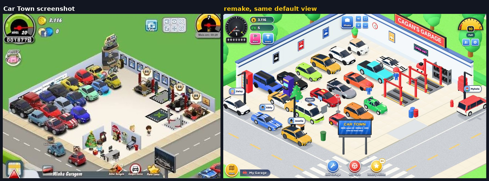
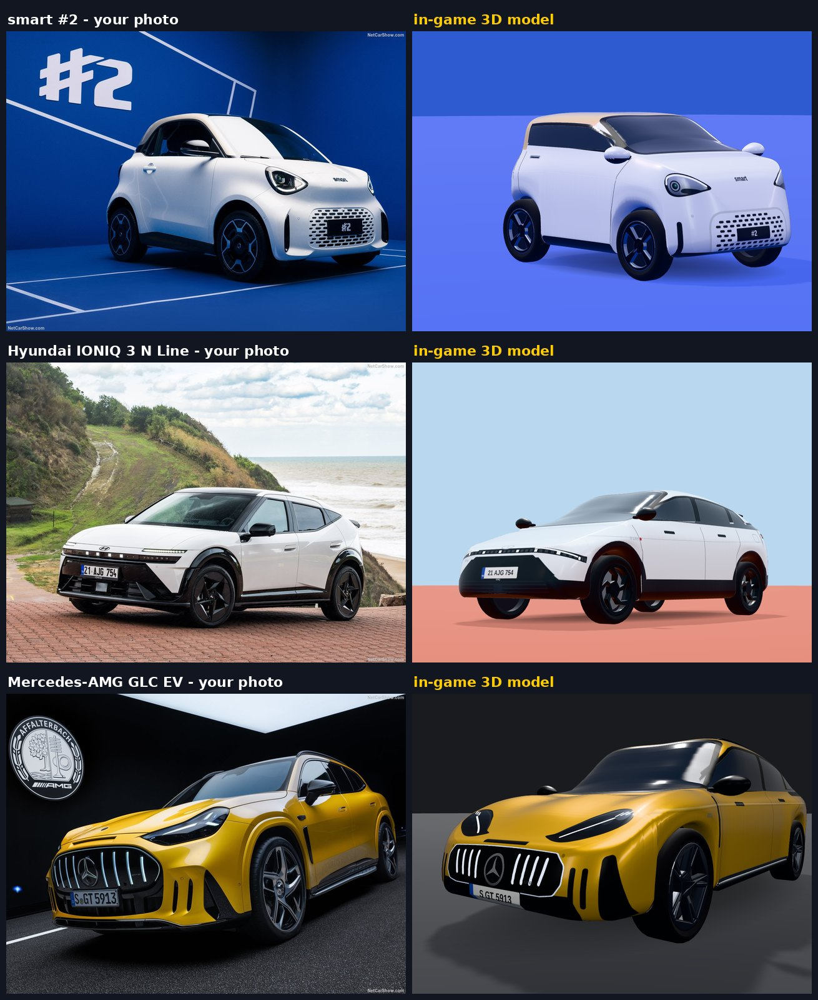
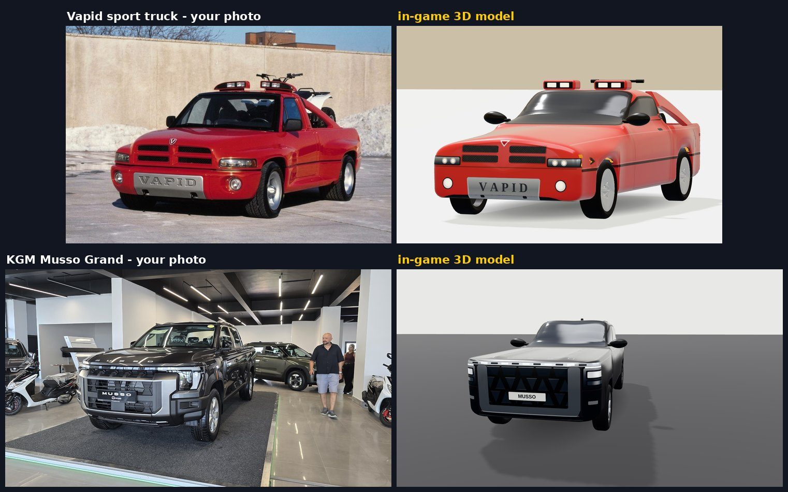
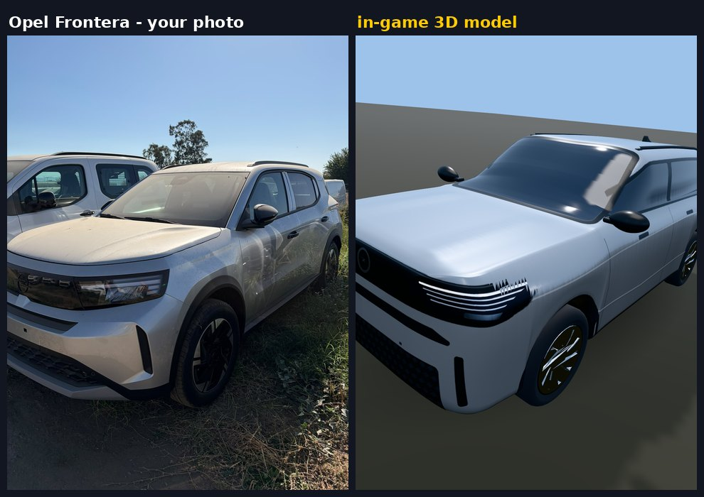

# Car Town — remake

**English** · [Español](README.md) · [Português (Brasil)](README.pt.md)

Car Town is a 3D browser remake of the classic social garage game, built with
[three.js](https://threejs.org). Run your own garage, service NPC customers for
coins and XP, buy and customize cars, decorate and expand your lot, drive around
town, and race other players over a quarter mile. The project also includes
accounts, per-user saves, friends, a wall, challenges, visits and a global
ranking. It is an unofficial, non-commercial fan project.

## Screenshots

These comparison images show the in-game garage and the cars recreated from the
reference photos.

| Garage vs. original | First car batch |
| --- | --- |
|  |  |

| Second car batch | Opel Frontera detail |
| --- | --- |
|  |  |

## Quick start

Requirements: Node.js 24+ and npm. The app is served under `/cartown/` by
default; set `CARTON_BASE_PATH=/` to serve it at the root. The public path must
match this value.

```bash
npm ci
npm run build
npm start
```

Open `http://localhost:3000/cartown/login`.

For development with hot reload, run `npm start` in one terminal and
`npm run dev` in another. Vite listens on `:5173` and proxies API requests to
the Node server on `:3000`.

```bash
npm start
npm run dev
```

## Accounts and administration

Accounts are local to this installation: username and password, no email. The
first visit redirects to the login page; registration is open by default.
Passwords are hashed with scrypt and sessions are stored server-side.

```bash
node server/admin.js ensure-owner YOUR_USER YOUR_PASSWORD
node server/admin.js list
node server/admin.js force-tutorial YOUR_USER
node server/admin.js set-money YOUR_USER 50000 25
node server/admin.js ranking-opt-out YOUR_USER
node server/admin.js audit 40
```

The web admin panel is at `/cartown/admin` after signing in with an admin
account. It can ban or unban accounts, reset saves or passwords, adjust level
and money, force the tutorial, manage ranking visibility and delete accounts.

## Configuration

| Variable | Default | Purpose |
| --- | --- | --- |
| `PORT` | `3000` | HTTP/WebSocket port. |
| `HOST` | `0.0.0.0` | Bind address. |
| `CARTON_BASE_PATH` | `/cartown` | Public URL prefix; `/` serves at the root. |
| `CARTON_DATA_DIR` | `var/` | Persistent snapshots and emergency files. |
| `CARTON_RAM_DIR` | `<data>/ram` | Live SQLite database; use tmpfs. |
| `CARTON_SNAPSHOT_MINUTES` | `5` | Snapshot interval. |
| `CARTON_REGISTRATION` | `open` | Set to `closed` to disable signups. |
| `CARTON_INVITE_CODE` | empty | Require an invite code while registration is open. |
| `CARTON_TRUST_PROXY` | `0` | Set to `1` behind a reverse proxy. |
| `CARTON_COOKIE_SECURE` | `0` | Set to `1` when TLS terminates at the proxy. |
| `CARTON_NAS_DIR` | `<data>/nas` | Optional snapshot copy directory. |

Progress is stored per user in SQLite, in RAM with snapshots. Jobs keep running
while the game is closed. The first visit lets you choose Spanish, English or
Brazilian Portuguese; the tutorial can be restarted from Settings.

## Docker and reverse proxy

```bash
docker compose up -d --build
```

The container listens only on `127.0.0.1:3000`, uses the default Docker network
and needs no external services. Put a reverse proxy in front and pass
`/cartown/` and `/cartown/ws` through without rewriting the prefix:

```nginx
location /cartown/ {
    proxy_pass http://127.0.0.1:3000;
    proxy_http_version 1.1;
    proxy_set_header Upgrade $http_upgrade;
    proxy_set_header Connection "upgrade";
    proxy_set_header Host $host;
    proxy_set_header X-Forwarded-Proto $scheme;
}
```

Set `CARTON_TRUST_PROXY=1` and `CARTON_COOKIE_SECURE=1` when the proxy handles
HTTPS. Persistent data lives in the `cartown_data` volume; the live SQLite
database lives in tmpfs. To copy snapshots off-host, mount a directory at
`/nas` and set `CARTON_NAS_DIR=/nas`.

## What's in the game

| Area | Features |
| --- | --- |
| **My Garage** | Isometric garage with posters, red service lifts, a corner billboard, a crossroads with traffic and friends' cars parked outside. |
| **Customers** | NPC cars arrive, park and request oil, tires, brakes, tuning, washing, waxing or repainting. Each service uses fuel and pays coins, XP and Luxury Point tips. |
| **Jobs** | Two real-time customer errands and one workshop slot that installs the next upgrade at a discount. |
| **Buy Cars** | Showroom with 21 vehicles, stats and a colour choice before purchase. |
| **Paint & Tune** | Finishes, two-tone roof, 13 rim designs, liveries, spoilers, tint, stance, underglow and mechanical upgrades. |
| **Edit Garage** | Buy, place, move, rotate and sell lifts, wash bays, paint booths, arcade machines, jukeboxes, tables and more. Includes floor/wall themes and lot expansions. |
| **Drag races** | Staged start, revving, shifting in the green zone and nitro. Race AI, NPC friends, online players or a second player on the same keyboard. |
| **Town** | Drive to the dealer, paint shop, drag strip, gas station, car wash, your garage and friends' houses, with traffic, pedestrians and a minimap. |
| **Social** | Add friends by username or code, post on the wall, like posts, send challenges, visit friends in read-only mode and use the global ranking. |
| **Other** | Spanish, English and Brazilian Portuguese, a guided tutorial, and code-generated sound effects and music. |

## Controls

| Where | Keys |
| --- | --- |
| Garage | Drag to pan; wheel or `+`/`−` to zoom. In the editor, `R` rotates and `Esc` cancels. |
| Solo race | `Space` or click to rev and shift; `N` fires nitro. |
| Two-player race | P1: `Z` rev/shift, `X` nitro. P2: `M` rev/shift, `N` nitro. |
| Town | `WASD` or arrows to drive, `Space` to brake, `E` to enter, `C` to change camera, `H` for the horn and `Esc` to return to the garage. |

## How cars are modelled

Cars are generated in code under `src/cars/`; there are no external mesh files.
`bodyV2.js` lofts a smooth body from curves measured in metres. `featured.js`,
`featured2.js` and `featured3.js` contain the eight featured cars.
`archetypes.js` and `generic.js` generate the rest of the line-up. Windows,
lights, grilles, plates and liveries are drawn on canvases and projected onto
the body. Each car has a detailed model for the showroom and races, plus a
lighter model for the garage, traffic and town.

`dev/cars.html` is a car lab for inspecting models, for example
`http://localhost:5173/dev/cars.html?model=amgsuv&view=fq&rot=0&dist=6`. It also
accepts an exact camera (`pos`, `look`, `fov`) and `env=studio` lighting.

## Project layout

```text
src/
  app.js            scene switching and system wiring
  core/             render loop, audio synth, i18n and utilities
  cars/             car generator, models, wheels and painter
  game/             state, economy, customers, drag physics, friends and netcode
  scenes/           garage, showroom, drag strip and town
  world/            props, characters, textures, traffic and surroundings
  ui/               HUD, dealer, paint shop, editor, race UI and panels
server/             auth, saves, social data, admin and WebSocket
tests/              tutorial state-machine tests
```

## Tests

```bash
npm test
npm run build
```

See [`JUEGO.md`](JUEGO.md) for more game details (Spanish). The project overview
is also available in Spanish as [`PROYECTO.md`](PROYECTO.md).

## Disclaimer

This is a non-commercial fan project and is not affiliated with Cie Games, Glu
or the original Car Town. Car makes and model names are trademarks of their
respective owners and are used only to identify the cars recreated here. All
models, textures and sounds in this repository are generated by code.
