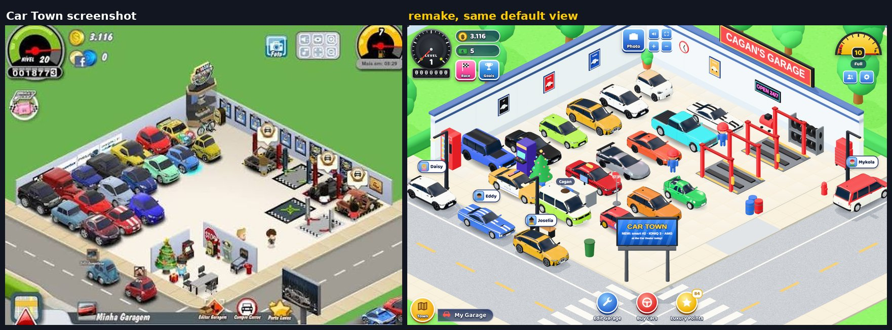
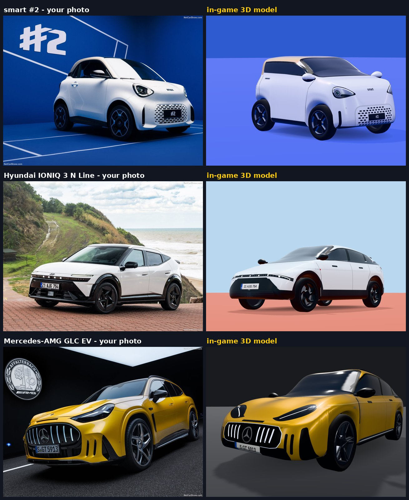
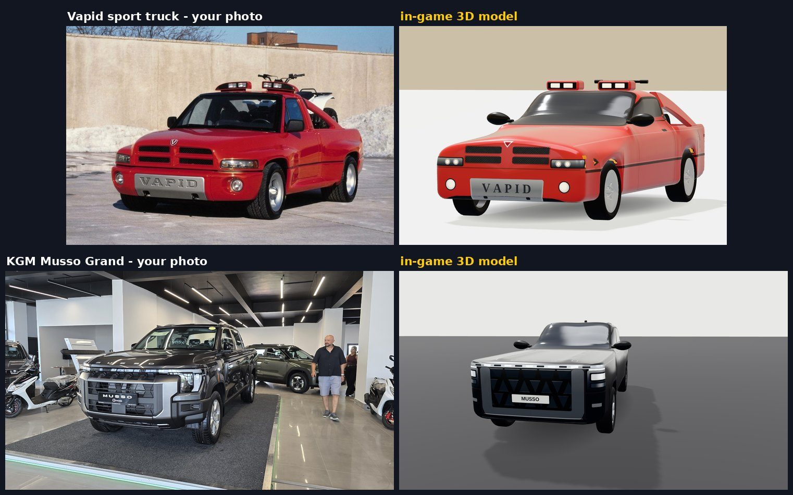
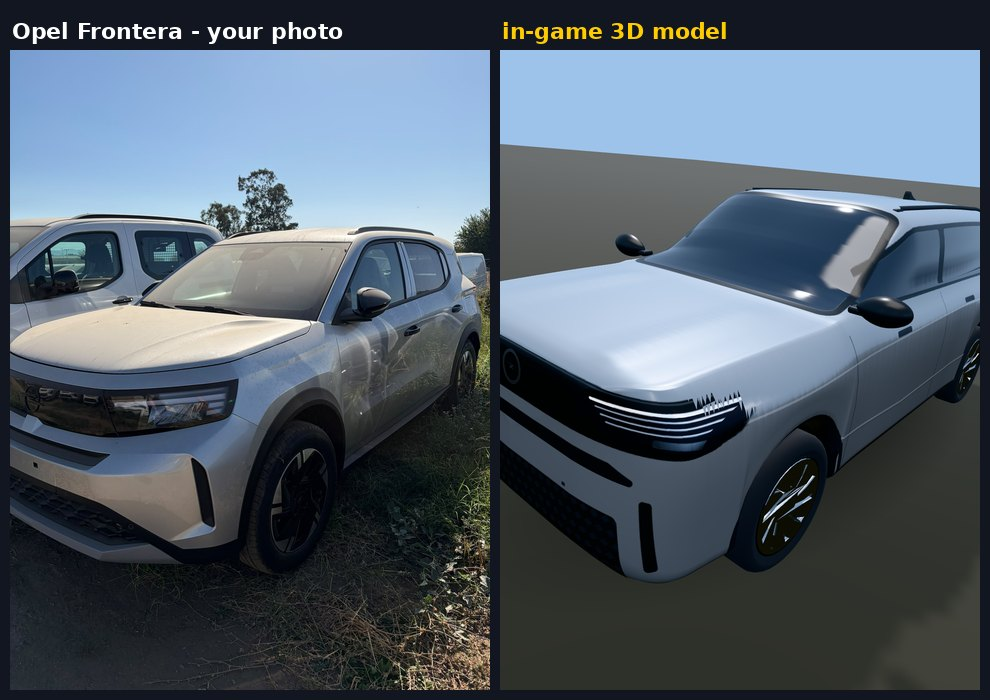

# Car Town — remake

[English](README.en.md) · [Português (Brasil)](README.pt.md) · **Español**

Car Town es un remake 3D para navegador del clásico juego social de garaje, creado con [three.js](https://threejs.org). Gestiona tu propio taller, atiende clientes, gana monedas y experiencia, compra y personaliza coches, decora y amplía tu garaje, conduce por el pueblo y compite en carreras de cuarto de milla.

El proyecto incluye cuentas propias, partidas por usuario, amigos, muro, retos, visitas y clasificación global. No es un proyecto oficial ni tiene fines comerciales.

## Capturas del juego

Las imágenes siguiente comparan el juego con el original y muestran los coches recreados a partir de las fotos de referencia.

| Garaje comparado con el original | Primera tanda de coches |
| --- | --- |
|  |  |

| Segunda tanda de coches | Detalle del Opel Frontera |
| --- | --- |
|  |  |

## Inicio rápido

Requisitos: Node.js 24 o superior y npm. El juego se sirve bajo `/cartown/` por defecto; define `CARTON_BASE_PATH=/` para servirlo en la raíz. La ruta pública debe coincidir con este valor.

```bash
npm ci
npm run build
npm start
```

Abre `http://localhost:3000/cartown/login`.

Para desarrollo con recarga automática, ejecuta `npm start` en una terminal y `npm run dev` en otra. Vite escucha en `:5173` y redirige la API al servidor Node en `:3000`.

```bash
npm start
npm run dev
```

## Cuentas y administración

Las cuentas son locales a esta instalación: nombre de usuario y contraseña, sin correo electrónico. La primera visita redirige al inicio de sesión; el registro está abierto por defecto. Las contraseñas se almacenan con scrypt y las sesiones se guardan en el servidor.

```bash
node server/admin.js ensure-owner TU_USUARIO TU_CONTRASEÑA
node server/admin.js list
node server/admin.js force-tutorial TU_USUARIO
node server/admin.js set-money TU_USUARIO 50000 25
node server/admin.js ranking-opt-out TU_USUARIO
node server/admin.js audit 40
```

El panel web de administración está en `/cartown/admin` después de iniciar sesión con una cuenta de administrador. Permite banear o desbanear cuentas, reiniciar partidas o contraseñas, ajustar nivel y dinero, forzar el tutorial, gestionar la visibilidad en la clasificación y eliminar cuentas.

## Configuración

| Variable | Valor por defecto | Función |
| --- | --- | --- |
| `PORT` | `3000` | Puerto HTTP y WebSocket. |
| `HOST` | `0.0.0.0` | Dirección de escucha. |
| `CARTON_BASE_PATH` | `/cartown` | Prefijo público; `/` sirve el juego en la raíz. |
| `CARTON_DATA_DIR` | `var/` | Snapshots persistentes y archivos de emergencia. |
| `CARTON_RAM_DIR` | `<data>/ram` | Base de SQLite en vivo; usa tmpfs. |
| `CARTON_SNAPSHOT_MINUTES` | `5` | Intervalo entre snapshots. |
| `CARTON_REGISTRATION` | `open` | `closed` desactiva los registros. |
| `CARTON_INVITE_CODE` | vacío | Solicita un código de invitación si el registro está abierto. |
| `CARTON_TRUST_PROXY` | `0` | Usa `1` detrás de un proxy inverso. |
| `CARTON_COOKIE_SECURE` | `0` | Usa `1` cuando TLS termina en el proxy. |
| `CARTON_NAS_DIR` | `<data>/nas` | Directorio opcional para copias de snapshots. |

El progreso se guarda por usuario en SQLite, en memoria y con snapshots. Los trabajos siguen avanzando aunque el juego esté cerrado. El primer inicio permite elegir español, inglés o portugués de Brasil; el tutorial puede repetirse desde Ajustes.

## Docker y proxy inverso

```bash
docker compose up -d --build
```

El contenedor escucha solo en `127.0.0.1:3000`, usa la red Docker predeterminada y no necesita servicios externos. Coloca delante un proxy inverso y pasa `/cartown/` y `/cartown/ws` sin reescribir el prefijo:

```nginx
location /cartown/ {
    proxy_pass http://127.0.0.1:3000;
    proxy_http_version 1.1;
    proxy_set_header Upgrade $http_upgrade;
    proxy_set_header Connection "upgrade";
    proxy_set_header Host $host;
    proxy_set_header X-Forwarded-Proto $scheme;
}
```

Cuando el proxy gestione HTTPS, activa `CARTON_TRUST_PROXY=1` y `CARTON_COOKIE_SECURE=1`. Los datos persistentes están en el volumen `cartown_data`; la base de datos en vivo está en tmpfs. Para copiar snapshots fuera del servidor, monta un directorio en `/nas` y define `CARTON_NAS_DIR=/nas`.

## Qué incluye

| Área | Características |
| --- | --- |
| **Mi garaje** | Garaje isométrico con pósters, elevadores rojos, cartel, cruce con tráfico y coches de amigos aparcados fuera. |
| **Clientes** | Coches NPC llegan, aparcan y piden aceite, neumáticos, frenos, puesta a punto, lavado, encerado o repintado. Cada servicio consume combustible y entrega monedas, experiencia y propinas. |
| **Trabajos** | Hasta dos encargos que avanzan en tiempo real y un hueco de taller para instalar mejoras a precio reducido. |
| **Comprar coches** | Concesionario con 21 vehículos, estadísticas y elección de color. |
| **Pintar y tuning** | Acabados, techo bicolor, 13 diseños de llantas, vinilos, alerones, cristales, suspensión, luces y mejoras mecánicas. |
| **Editar garaje** | Compra, coloca, mueve, gira y vende elevadores, lavadero, cabina de pintura, arcade, jukebox, mesas y mucho más. Incluye temas de suelo y paredes y ampliaciones del solar. |
| **Carreras** | Salida con semáforo, revolucionar, cambiar en la zona verde y nitro. Carreras de cuarto de milla contra IA, amigos NPC, rivales en línea o un segundo jugador en el mismo teclado. |
| **Pueblo** | Conduce por el concesionario, taller, circuito, gasolinera, lavadero, tu garaje y casas de amigos, con tráfico, peatones y minimapa. |
| **Social** | Amigos por nombre de usuario o código, muro, me gusta, retos, visitas de solo lectura y clasificación global. |
| **Otros** | Español, inglés y portugués, tutorial guiado y sonidos generados por código. |

## Controles

| Zona | Controles |
| --- | --- |
| Garaje | Arrastra para mover, rueda o `+`/`−` para acercar. En el editor, `R` gira y `Esc` cancela. |
| Carrera en solitario | `Espacio` o clic para revolucionar y cambiar; `N` activa el nitro. |
| Carrera a dos jugadores | P1: `Z` revoluciona/cambia y `X` nitro. P2: `M` revoluciona/cambia y `N` nitro. |
| Pueblo | `WASD` o flechas para conducir, `Espacio` frena, `E` entra, `C` cambia la cámara, `H` toca el claxon y `Esc` vuelve al garaje. |

## Cómo se modelan los coches

Los coches se generan por código en `src/cars/`; no hay archivos de malla externos. `bodyV2.js` crea una carrocería lisa a partir de curvas medidas en metros; `featured.js`, `featured2.js` y `featured3.js` contienen los ocho coches destacados; `archetypes.js` y `generic.js` generan el resto de modelos. Los cristales, faros, parrillas, matrículas y vinilos se dibujan en lienzos y se proyectan sobre la carrocería. Cada coche tiene dos niveles de detalle: uno para expositor y carreras, y otro ligero para garaje, tráfico y pueblo.

`dev/cars.html` sirve como laboratorio para inspeccionar los modelos, por ejemplo `http://localhost:5173/dev/cars.html?model=amgsuv&view=fq&rot=0&dist=6`. También admite cámara exacta (`pos`, `look`, `fov`) e iluminación `env=studio`.

## Estructura del proyecto

```text
src/
  app.js            cambio de escenas y conexión de sistemas
  core/             bucle de render, audio, i18n y utilidades
  cars/             generación de coches, ruedas y pintura
  game/             estado, economía, clientes, carreras, amigos y red
  scenes/           garaje, expositor, circuito y pueblo
  world/            objetos, personajes, texturas, tráfico y entorno
  ui/               HUD, tienda, pintura, editor, carreras y paneles
server/             autenticación, guardados, social, administración y WebSocket
tests/              pruebas de la máquina del tutorial
```

## Pruebas

```bash
npm test
npm run build
```

Para más detalles del juego consulta [`JUEGO.md`](JUEGO.md) y, en español, [`PROYECTO.md`](PROYECTO.md).

## Aviso legal

Este proyecto es fan-made, no comercial y no está afiliado a Cie Games, Glu ni al Car Town original. Los nombres de marcas y modelos se usan únicamente para identificar los coches recreados. Todos los modelos, texturas y sonidos de este repositorio se generan por código.
