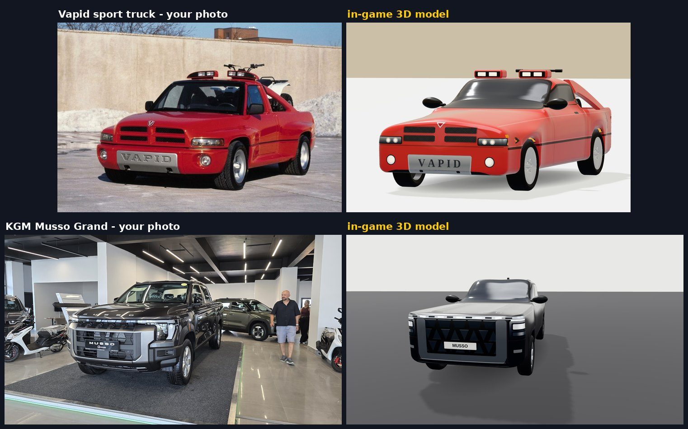
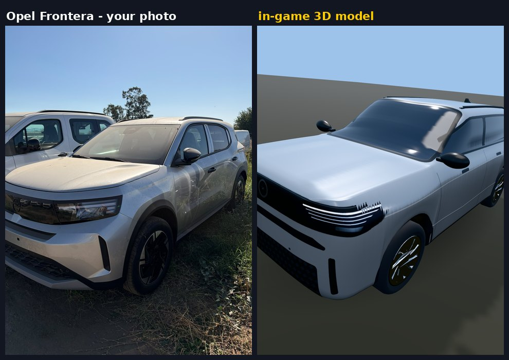
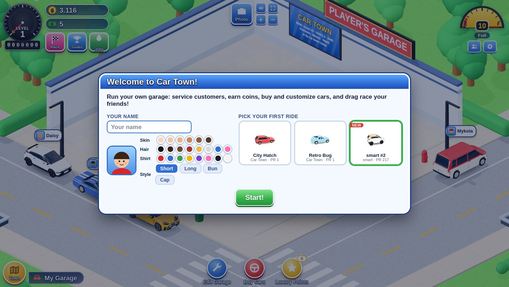
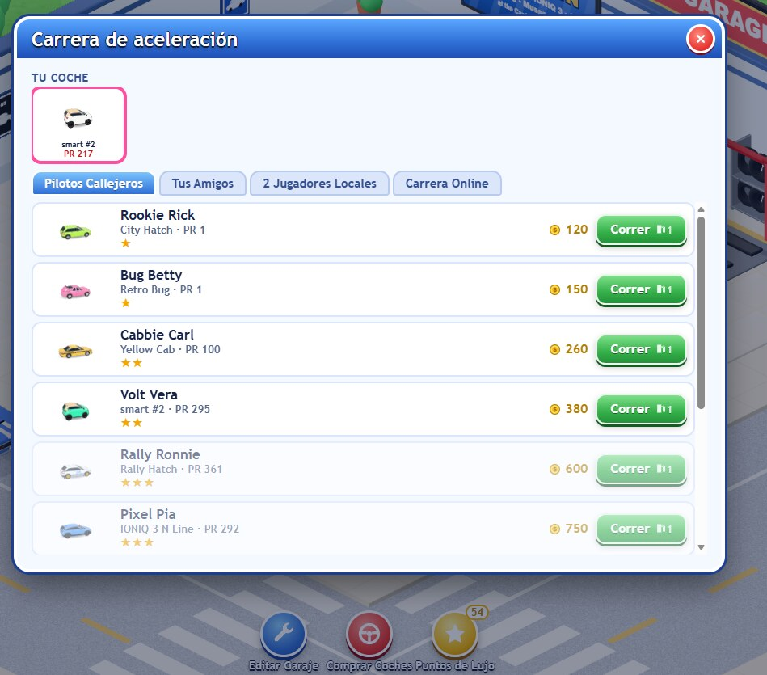
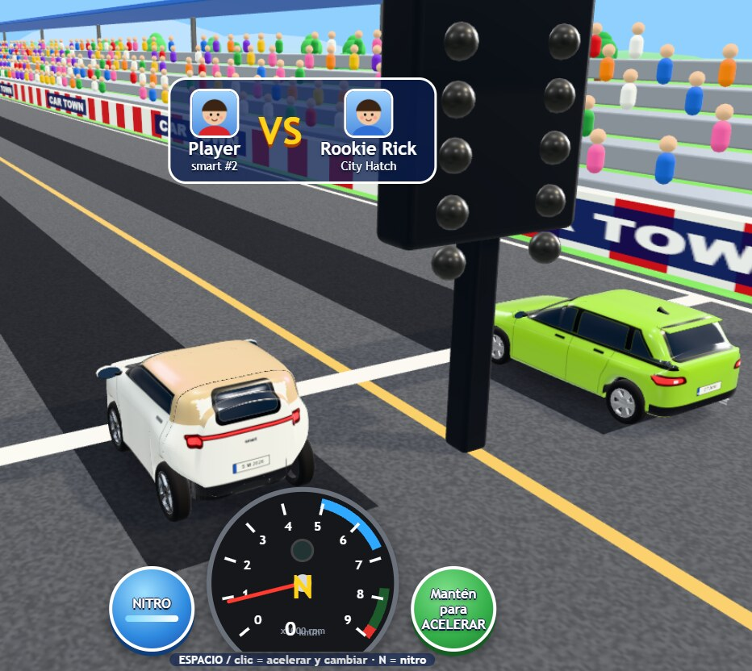
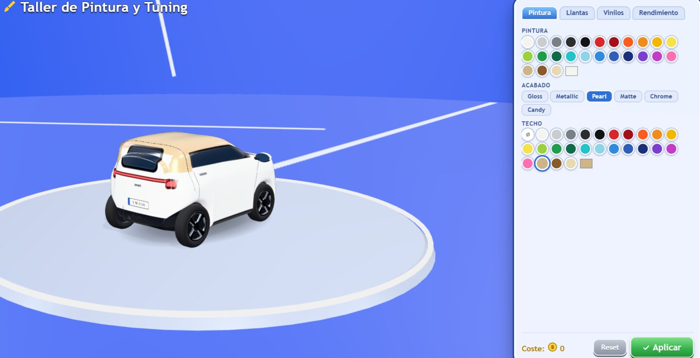

# Car Town — remake 3D

[English](README.en.md) · [Español](README.md) · **Português (Brasil)**

Car Town é um remake 3D para navegador do clássico jogo social de garagem, criado com [three.js](https://threejs.org). É um projeto fã, não oficial e sem fins comerciais: todos os modelos, texturas e sons são gerados por código.

Gerencie sua oficina, atenda clientes, compre e ajuste carros, decore e amplie a garagem, dirija por uma cidade viva, dispute corridas de um quarto de milha e compartilhe o progresso com amigos.

## Capturas do jogo

As imagens abaixo são capturas do jogo comparadas com o original e com as fotos de referência usadas para modelar os carros.

| Garagem do jogo comparada com o original | Primeiro lote de carros |
| --- | --- |
|  |  |

| Segundo lote de carros | Detalhe do Opel Frontera |
| --- | --- |
|  |  |

Capturas diretas de uma partida; há mais no [`MANUAL.md`](MANUAL.md) (em espanhol):

| Garagem e cidade | Menu de Corridas com miniaturas 3D |
| --- | --- |
|  |  |

| Corrida de um quarto de milha | Concessionária e personalização |
| --- | --- |
|  |  |

## Um passeio pelo jogo

1. **Abra sua garagem.** Escolha o idioma, siga o tutorial e acompanhe o HUD: dinheiro, experiência, nível, combustível, trabalhos e menu principal.
2. **Atenda clientes da rua.** Carros NPC chegam e pedem óleo, pneus, freios, ajuste, lavagem, cera ou repintura. São tarefas curtas de **1-3 minutos** com pagamento baixo: moedas base do serviço mais gorjetas de luxo/nível, além de XP.
3. **Use o painel Trabalhos.** Aceite até **8 tarefas longas** (até **24 h** e **2600 moedas**) que continuam avançando com o jogo fechado; além disso, inicie melhorias dos seus carros em paralelo enquanto houver elevadores e mecânicos livres, com desconto.
4. **Compre e prepare carros.** A concessionária mostra 21 veículos com estatísticas e cor inicial. Depois é possível mudar acabamento, teto bicolor, rodas, adesivos, spoilers, película, suspensão, luzes e mecânica.
5. **Decore a garagem.** Compre, coloque, mova, gire e venda elevadores, lava-jato, cabine de pintura, fliperama, jukebox, mesas, ferramentas, tapetes e baldosas. Há temas de piso e parede e ampliação do terreno.
6. **Dirija pela cidade.** Visite a concessionária, pintura, pista, posto, lava-jato, sua garagem e casas de amigos. A cidade tem ruas, calçadas elevadas, faixas de pedestres, parques, mobiliário, tráfego, pedestres e minimapa.
7. **Corra o quarto de milha.** Largada com semáforo, acelerar, trocar de marcha na zona verde e nitro. Compita contra IA, amigos NPC, adversários online ou um segundo jogador no mesmo teclado.
8. **Faça amigos.** Adicione usuários por nome ou código, publique no mural, curta publicações, envie desafios, visite oficinas alheias em modo somente leitura e suba no ranking global.

## O que o jogo inclui

| Área | Recursos |
| --- | --- |
| **Minha garagem** | Garagem isométrica com pôsteres, elevadores vermelhos, letreiro na parede, cordão de veludo, cruzamento com tráfego, carros de amigos estacionados do lado de fora e editor de objetos. |
| **Clientes** | Carros NPC pedem óleo, pneus, freios, ajuste, lavagem, cera e repintura. Cada serviço consome combustível e rende moedas, experiência e gorjetas. |
| **Trabalhos** | Carros da rua de 1-3 min com pagamento baixo; até 8 tarefas no painel de até 24 h e 2600 moedas, progresso persistente e melhorias próprias simultâneas limitadas por elevadores e mecânicos livres. |
| **Comprar carros** | Concessionária com 21 veículos, estatísticas, oito modelos em destaque e escolha de cor antes da compra. |
| **Pintura e tuning** | Acabamentos, teto bicolor, 13 desenhos de rodas, adesivos, spoilers, película, suspensão, underglow e melhorias mecânicas. |
| **Editar garagem** | Compre, coloque, mova, gire e venda elevadores, lava-jato, cabine de pintura, fliperama, jukebox, mesas, ferramentas e baldosas. Inclui temas de piso e parede, ampliação e ferramentas que se encaixam em mesas. |
| **Cidade** | Ruas, calçadas elevadas, faixas de pedestres, postes alinhados, áreas verdes, mobiliário, tráfego, pedestres e minimapa. Entre na concessionária, pintura, pista, posto, lava-jato, garagem e casas de amigos. |
| **Corridas** | Largada com semáforo, acelerar, trocar de marcha na zona verde e nitro. Corridas de um quarto de milha contra IA, amigos NPC, adversários online ou um segundo jogador no mesmo teclado. |
| **Social** | Amigos por nome ou código, mural, curtidas, desafios, visitas somente leitura e ranking global. |
| **Tutorial e acessibilidade** | Tutorial guiado em espanhol, inglês e português, com etapas persistentes, eventos identificados, avisos acessíveis e repetição em Ajustes. |
| **Som** | Efeitos e música sintetizados por código; não há arquivos de áudio externos. |

## Controles

| Área | Teclas |
| --- | --- |
| Garagem | Arraste para mover; roda ou `+`/`−` para zoom. No editor, `R` gira e `Esc` cancela. |
| Concessionária | Use o HUD para comparar carros, escolher cor e comprar. |
| Corrida individual | `Espaço` ou clique para acelerar e trocar de marcha; `N` ativa o nitro. |
| Corrida para dois jogadores | P1: `Z` acelera/troca, `X` nitro. P2: `M` acelera/troca, `N` nitro. |
| Cidade | `WASD` ou setas para dirigir, `Espaço` freia, `E` entra, `C` muda a câmera, `H` buzina e `Esc` volta à garagem. |

## Saves e progresso

- Cada usuário tem um save independente armazenado em SQLite.
- O banco ativo fica em memória e é persistido por snapshots automáticos; os trabalhos continuam andando com o jogo fechado.
- Na primeira visita é possível escolher espanhol, inglês ou português do Brasil; o tutorial pode ser repetido em Ajustes.
- As contas são locais nesta instalação: nome de usuário e senha, sem e-mail. As senhas usam scrypt e as sessões ficam no servidor.

## Início rápido

Requisitos: Node.js 24 ou superior e npm. O jogo é servido em `/cartown/` por padrão; defina `CARTON_BASE_PATH=/` para servir na raiz. O caminho público deve corresponder a esse valor.

```bash
npm ci
npm run build
npm start
```

Abra `http://localhost:3000/cartown/login`.

Para recarga automática, execute `npm start` em um terminal e `npm run dev` em outro. O Vite escuta em `:5173` e redireciona a API para o servidor Node em `:3000`.

```bash
npm start
npm run dev
```

## Contas e administração

```bash
node server/admin.js ensure-owner SEU_USUARIO SUA_SENHA
node server/admin.js list
node server/admin.js force-tutorial SEU_USUARIO
node server/admin.js set-money SEU_USUARIO 50000 25
node server/admin.js ranking-opt-out SEU_USUARIO
node server/admin.js audit 40
```

O painel administrativo fica em `/cartown/admin` após entrar com uma conta de administrador. Ele permite banir ou desbanir contas, reiniciar saves ou senhas, ajustar nível e dinheiro, forçar o tutorial, gerenciar a visibilidade no ranking e excluir contas.

## Configuração

| Variável | Padrão | Função |
| --- | --- | --- |
| `PORT` | `3000` | Porta HTTP e WebSocket. |
| `HOST` | `0.0.0.0` | Endereço de escuta. |
| `CARTON_BASE_PATH` | `/cartown` | Prefixo público; `/` serve na raiz. |
| `CARTON_DATA_DIR` | `var/` | Snapshots persistentes e arquivos de emergência. |
| `CARTON_RAM_DIR` | `<data>/ram` | Banco SQLite ativo; use tmpfs. |
| `CARTON_SNAPSHOT_MINUTES` | `5` | Intervalo entre snapshots. |
| `CARTON_REGISTRATION` | `open` | `closed` desativa novos registros. |
| `CARTON_INVITE_CODE` | vazio | Exige um código de convite enquanto o registro está aberto. |
| `CARTON_SESSION_DAYS` | `30` | Duração das sessões. |
| `CARTON_TRUST_PROXY` | `0` | Use `1` atrás de um proxy reverso. |
| `CARTON_COOKIE_SECURE` | `0` | Use `1` quando o TLS termina no proxy. |
| `CARTON_MAX_STATE_BYTES` | `2097152` | Tamanho máximo aceito para um save. |
| `CARTON_NAS_DIR` | `<data>/nas` | Diretório opcional para cópias de snapshots. |

## Docker e proxy reverso

```bash
docker compose up -d --build
```

O contêiner escuta apenas em `127.0.0.1:3000`, usa a rede Docker padrão e não precisa de serviços externos. Coloque um proxy reverso na frente e passe `/cartown/` e `/cartown/ws` sem reescrever o prefixo:

```nginx
location /cartown/ {
    proxy_pass http://127.0.0.1:3000;
    proxy_http_version 1.1;
    proxy_set_header Upgrade $http_upgrade;
    proxy_set_header Connection "upgrade";
    proxy_set_header Host $host;
    proxy_set_header X-Forwarded-Proto $scheme;
}
```

Quando o proxy cuidar de HTTPS, ative `CARTON_TRUST_PROXY=1` e `CARTON_COOKIE_SECURE=1`. Os dados persistentes ficam no volume `cartown_data`; o banco SQLite ativo fica em tmpfs. Para copiar snapshots para fora do servidor, monte um diretório em `/nas` e defina `CARTON_NAS_DIR=/nas`.

## Como os carros são modelados

Os carros são gerados por código em `src/cars/`; não há arquivos de malha externos. `bodyV2.js` cria uma carroceria lisa a partir de curvas medidas em metros. `featured.js`, `featured2.js` e `featured3.js` contêm os oito carros em destaque. `archetypes.js` e `generic.js` geram o restante dos modelos. Janelas, faróis, grades, placas e adesivos são desenhados em telas e projetados na carroceria. Cada carro tem um modelo detalhado para vitrine e corridas, além de um modelo mais leve para garagem, tráfego e cidade.

`dev/cars.html` é um laboratório para inspecionar os modelos, por exemplo `http://localhost:5173/dev/cars.html?model=amgsuv&view=fq&rot=0&dist=6`. Também aceita câmera exata (`pos`, `look`, `fov`) e iluminação `env=studio`.

## Estrutura do projeto

```text
src/
  app.js            troca de cenas e conexão dos sistemas
  core/             loop de renderização, áudio, i18n e utilidades
  cars/             geração de carros, rodas e pintura
  game/             estado, economia, clientes, corridas, amigos e rede
  scenes/           garagem, vitrine, pista e cidade
  world/            objetos, personagens, texturas, tráfego e ambiente
  ui/               HUD, loja, pintura, editor, corridas e painéis
server/             autenticação, saves, dados sociais, admin e WebSocket
tests/              testes da máquina de tutorial
```

## Testes

```bash
npm test
npm run build
```

Para mais detalhes do jogo, consulte [`JUEGO.md`](JUEGO.md) e, em espanhol, [`PROYECTO.md`](PROYECTO.md). O manual detalhado com capturas está em [`MANUAL.md`](MANUAL.md) (espanhol).

## Aviso legal

Este projeto é fã, não comercial e não está afiliado à Cie Games, Glu nem ao Car Town original. Os nomes de marcas e modelos são usados apenas para identificar os carros recriados. Todos os modelos, texturas e sons deste repositório são gerados por código.

## Licença e autor

Licença: todos os direitos reservados. Este projeto é para uso pessoal e não comercial; não é permitida a redistribuição nem o uso comercial sem autorização.

Autor: indicado na assinatura no final deste README.

## Assinatura

<p align="center">
  <br>
  Created by <b>Rober Da Silva (DjGuesh)</b> · Rsilva Corp Limited
</p>

<h2 align="center">
  &nbsp;&nbsp;
  100% Spanish product&nbsp;&nbsp;
  
</h2>
