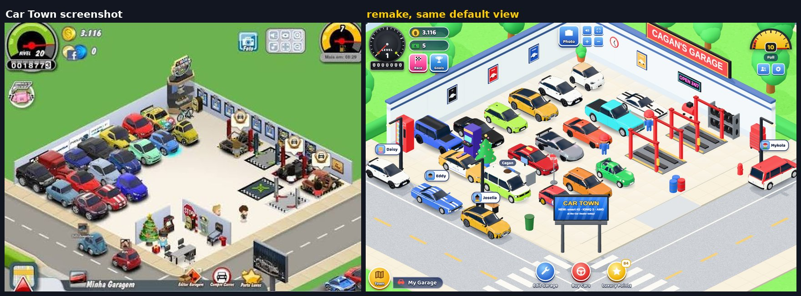
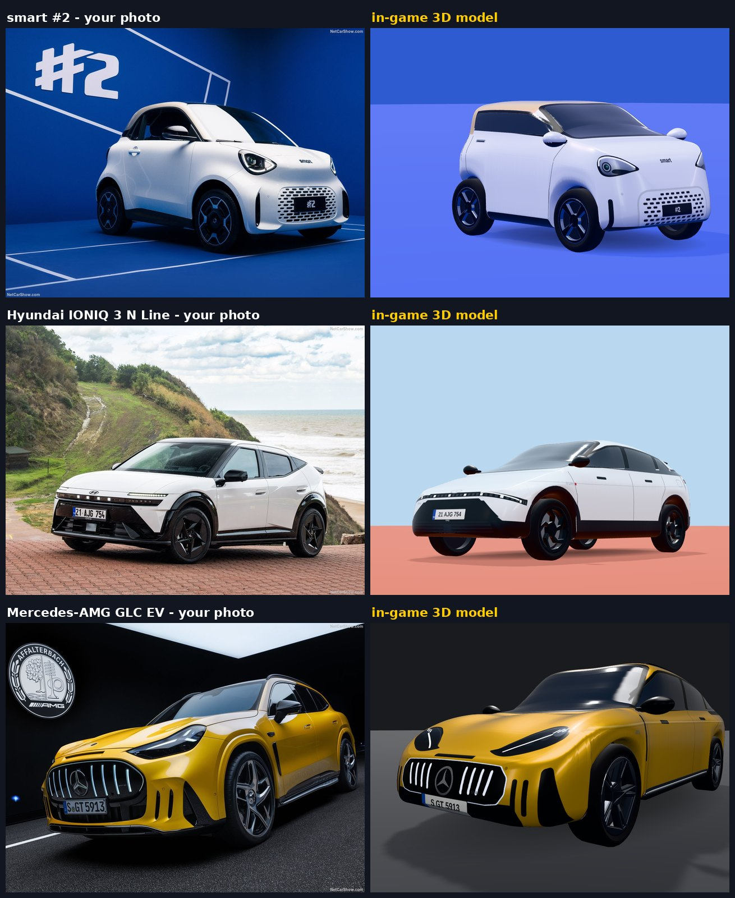

# Car Town — remake

[English](README.en.md) · [Español](README.md) · **Português (Brasil)**

Car Town é um remake 3D para navegador do clássico jogo social de garagem, criado com [three.js](https://threejs.org). Gerencie sua própria oficina, atenda clientes, ganhe moedas e experiência, compre e personalize carros, decore e amplie o terreno, dirija pela cidade e dispute corridas de quarto de milha.

O projeto inclui contas próprias, saves por usuário, amigos, mural, desafios, visitas e classificação global. Não é um projeto oficial nem tem fins comerciais.

## Capturas do jogo

As imagens abaixo comparam o jogo com o original e mostram os carros recriados a partir das fotos de referência.

| Garagem comparada com o original | Primeiro lote de carros |
| --- | --- |
|  |  |

| Segundo lote de carros | Detalhe do Opel Frontera |
| --- | --- |
|  |  |

## Início rápido

Requisitos: Node.js 24 ou superior e npm. O jogo é servido em `/cartown/` por padrão; defina `CARTON_BASE_PATH=/` para servir na raiz. O caminho público deve corresponder a esse valor.

```bash
npm ci
npm run build
npm start
```

Abra `http://localhost:3000/cartown/login`.

Para desenvolvimento com recarga automática, execute `npm start` em um terminal e `npm run dev` em outro. O Vite escuta em `:5173` e redireciona a API para o servidor Node em `:3000`.

```bash
npm start
npm run dev
```

## Contas e administração

As contas são locais nesta instalação: nome de usuário e senha, sem e-mail. A primeira visita redireciona para o login; o registro está aberto por padrão. As senhas são armazenadas com scrypt e as sessões ficam no servidor.

```bash
node server/admin.js ensure-owner SEU_USUARIO SUA_SENHA
node server/admin.js list
node server/admin.js force-tutorial SEU_USUARIO
node server/admin.js set-money SEU_USUARIO 50000 25
node server/admin.js ranking-opt-out SEU_USUARIO
node server/admin.js audit 40
```

O painel administrativo fica em `/cartown/admin` após entrar com uma conta de administrador. Ele permite banir ou desbanir contas, reiniciar saves ou senhas, ajustar nível e dinheiro, forçar o tutorial, gerenciar a visibilidade na classificação e excluir contas.

## Configuração

| Variável | Padrão | Função |
| --- | --- | --- |
| `PORT` | `3000` | Porta HTTP e WebSocket. |
| `HOST` | `0.0.0.0` | Endereço de escuta. |
| `CARTON_BASE_PATH` | `/cartown` | Prefixo público; `/` serve na raiz. |
| `CARTON_DATA_DIR` | `var/` | Snapshots persistentes e arquivos de emergência. |
| `CARTON_RAM_DIR` | `<data>/ram` | Banco SQLite ativo; use tmpfs. |
| `CARTON_SNAPSHOT_MINUTES` | `5` | Intervalo entre snapshots. |
| `CARTON_REGISTRATION` | `open` | `closed` desativa novos registros. |
| `CARTON_INVITE_CODE` | vazio | Exige um código de convite enquanto o registro está aberto. |
| `CARTON_TRUST_PROXY` | `0` | Use `1` atrás de um proxy reverso. |
| `CARTON_COOKIE_SECURE` | `0` | Use `1` quando o TLS termina no proxy. |
| `CARTON_NAS_DIR` | `<data>/nas` | Diretório opcional para cópias de snapshots. |

O progresso é salvo por usuário em SQLite, em memória com snapshots. Os trabalhos continuam avançando com o jogo fechado. Na primeira visita é possível escolher espanhol, inglês ou português do Brasil; o tutorial pode ser repetido em Ajustes.

## Docker e proxy reverso

```bash
docker compose up -d --build
```

O contêiner escuta apenas em `127.0.0.1:3000`, usa a rede Docker padrão e não precisa de serviços externos. Coloque um proxy reverso na frente e passe `/cartown/` e `/cartown/ws` sem reescrever o prefixo:

```nginx
location /cartown/ {
    proxy_pass http://127.0.0.1:3000;
    proxy_http_version 1.1;
    proxy_set_header Upgrade $http_upgrade;
    proxy_set_header Connection "upgrade";
    proxy_set_header Host $host;
    proxy_set_header X-Forwarded-Proto $scheme;
}
```

Quando o proxy cuidar de HTTPS, ative `CARTON_TRUST_PROXY=1` e `CARTON_COOKIE_SECURE=1`. Os dados persistentes ficam no volume `cartown_data`; o banco SQLite ativo fica em tmpfs. Para copiar snapshots para fora do servidor, monte um diretório em `/nas` e defina `CARTON_NAS_DIR=/nas`.

## O que o jogo inclui

| Área | Recursos |
| --- | --- |
| **Minha garagem** | Garagem isométrica com pôsteres, elevadores vermelhos, letreiro, cruzamento com tráfego e carros de amigos estacionados do lado de fora. |
| **Clientes** | Carros NPC chegam, estacionam e pedem óleo, pneus, freios, ajuste, lavagem, cera ou repintura. Cada serviço consome combustível e rende moedas, experiência e gorjetas. |
| **Trabalhos** | Até duas tarefas em tempo real e uma vaga na oficina para instalar a próxima melhoria com desconto. |
| **Comprar carros** | Concessionária com 21 veículos, estatísticas e escolha de cor antes da compra. |
| **Pintura e tuning** | Acabamentos, teto bicolor, 13 desenhos de rodas, adesivos, spoilers, película, suspensão, luzes e melhorias mecânicas. |
| **Editar garagem** | Compre, coloque, mova, gire e venda elevadores, lava-jato, cabine de pintura, fliperama, jukebox, mesas e muito mais. Inclui temas de piso e parede e ampliação do terreno. |
| **Corridas** | Largada com semáforo, acelerar, trocar de marcha na zona verde e nitro. Corridas de quarto de milha contra IA, amigos NPC, adversários online ou um segundo jogador no mesmo teclado. |
| **Cidade** | Dirija até a concessionária, pintura, pista, posto, lava-jato, sua garagem e casas de amigos, com tráfego, pedestres e minimapa. |
| **Social** | Amigos por nome ou código, mural, curtidas, desafios, visitas somente leitura e classificação global. |
| **Outros** | Espanhol, inglês e português, tutorial guiado e sons gerados por código. |

## Controles

| Área | Teclas |
| --- | --- |
| Garagem | Arraste para mover; roda ou `+`/`−` para zoom. No editor, `R` gira e `Esc` cancela. |
| Corrida individual | `Espaço` ou clique para acelerar e trocar de marcha; `N` ativa o nitro. |
| Corrida para dois jogadores | P1: `Z` acelera/troca, `X` nitro. P2: `M` acelera/troca, `N` nitro. |
| Cidade | `WASD` ou setas para dirigir, `Espaço` freia, `E` entra, `C` muda a câmera, `H` buzina e `Esc` volta à garagem. |

## Como os carros são modelados

Os carros são gerados por código em `src/cars/`; não há arquivos de malha externos. `bodyV2.js` cria uma carroceria lisa a partir de curvas medidas em metros. `featured.js`, `featured2.js` e `featured3.js` contêm os oito carros em destaque. `archetypes.js` e `generic.js` geram o restante dos modelos. Janelas, faróis, grades, placas e adesivos são desenhados em telas e projetados na carroceria. Cada carro tem um modelo detalhado para vitrine e corridas, além de um modelo mais leve para garagem, tráfego e cidade.

`dev/cars.html` é um laboratório para inspecionar os modelos, por exemplo `http://localhost:5173/dev/cars.html?model=amgsuv&view=fq&rot=0&dist=6`. Também aceita câmera exata (`pos`, `look`, `fov`) e iluminação `env=studio`.

## Estrutura do projeto

```text
src/
  app.js            troca de cenas e conexão dos sistemas
  core/             loop de renderização, áudio, i18n e utilidades
  cars/             geração de carros, rodas e pintura
  game/             estado, economia, clientes, corridas, amigos e rede
  scenes/           garagem, vitrine, pista e cidade
  world/            objetos, personagens, texturas, tráfego e ambiente
  ui/               HUD, loja, pintura, editor, corridas e painéis
server/             autenticação, saves, dados sociais, admin e WebSocket
tests/              testes da máquina de tutorial
```

## Testes

```bash
npm test
npm run build
```

Para mais detalhes do jogo, consulte [`JUEGO.md`](JUEGO.md) e, em espanhol, [`PROYECTO.md`](PROYECTO.md).

## Aviso legal

Este projeto é fan-made, não comercial e não está afiliado à Cie Games, Glu nem ao Car Town original. Os nomes de marcas e modelos são usados apenas para identificar os carros recriados. Todos os modelos, texturas e sons deste repositório são gerados por código.
